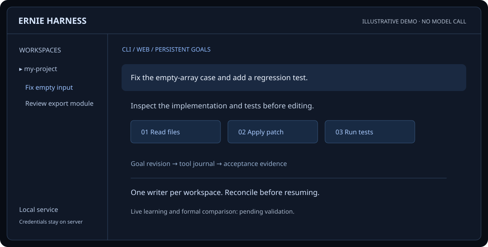

<div align="center">
  
  <h1>ERNIE Harness</h1>
  <p><strong>One coding core. Terminal, Web, and persistent goals.</strong></p>
  <p>An independent TypeScript workspace built around ERNIE 5.5 Flash Preview.</p>
  <p><a href="README.zh-CN.md">简体中文</a> · <a href="https://luminousyyh.github.io/ernie-harness/en/">Website &amp; docs</a> · <a href="docs/user/guide.md">Usage guide</a> · <a href="docs/maturity.md">Evidence &amp; status</a></p>
  <p><a href="LICENSE"></a>  </p>
</div>

Read a repository, make a change, run an acceptance check, and keep the evidence with the goal. CLI, terminal UI, and the local Web workspace share an execution engine, a SQLite journal, and cumulative budgets. The application defaults to Chinese; the documentation site has complete Chinese and English pages.

**Status: integration and validation.** Learning, extensions, and isolated improvement mechanisms are under active integration. Local checks, live model smoke tests, and formal comparison results are separate evidence. The current version is **not declared mature**. Live learning/improvement validation and the formal comparison are **pending, not completed**. See [maturity gates](docs/maturity.md) before drawing a performance conclusion.



*Authored interface illustration. [Explore the interactive static demo](https://luminousyyh.github.io/ernie-harness/en/#experience). It uses illustrative data and makes no model calls. Actual product recordings are pending review and recording.*

## Capabilities

| Area | What the harness does | Boundary / evidence |
| --- | --- | --- |
| Coding tools | File reads, search, patch edits, shell commands, test commands, and Git diffs | Local shell is trusted execution; file checks are not a general OS sandbox |
| Shared workspace | CLI, terminal, Web, workspace selection, and independent chats | One writer per workspace; UI uses HTTP/SSE and receives no model secrets |
| Persistent goals | Plans, checkpoints, dependencies, pause/resume, and versioned acceptance | Uncertain write effects must be reconciled before recovery |
| Model and budget | A single allowed free ERNIE route; account for retries and auxiliary requests | No paid or alternate-model fallback; free quota and availability can vary |
| Context | Separate active usage, advertised limits, estimates, and compaction | An estimated token count is not a provider measurement |
| Learning | Attributed memory candidates, scoped retrieval, reflection and curation modules | Integration in progress; no demonstrated cross-task learning benefit yet |
| Extensions | AGENTS/skills discovery, MCP configuration and trusted plugin interfaces | New modules are being integrated; source interfaces and tests define support |
| Improvement | Candidate search, isolated repositories, evaluation records and archives | Promotion requires evidence and policy gates; no automatic performance claim |
| Evaluation | Recorded development/formal protocols and an evidence viewer | A manifest or simulated result is not a completed live trial |

## Quick start

Use **Node.js 24.9+** and **pnpm 10.30.3** on Windows or Linux. You need OpenRouter access to the designated free route for actual model use.

```sh
git clone https://github.com/Luminousyyh/ernie-harness.git
cd ernie-harness
pnpm install --frozen-lockfile
pnpm build
pnpm cli setup
pnpm cli open
```

`setup` accepts credentials with hidden input. Windows stores them with the current user's DPAPI; Linux uses a private credential file. You may instead provide `OPENROUTER_API_KEY` through your runtime environment. Never put a real key in a committed config, command transcript, screenshot, or browser page.

`open` starts or reuses the local service and opens the authenticated workspace. On Windows, `start-ernie.cmd` is another entry point. Use `pnpm cli serve --open` for a foreground service. The service defaults to `127.0.0.1:4317`; its local launch token is separate from the model credential. Keep the authenticated launch URL local.

## Work with a project

The examples below use a Windows-style project path; on Linux substitute an absolute path such as `/home/you/projects/my-app`.

```sh
pnpm cli workspace add "D:/projects/my-app" --name "my-app"
pnpm cli workspace list
pnpm cli workspace select <workspace-id>
pnpm cli tui -w "D:/projects/my-app"
pnpm cli run "Fix the empty-array edge case and add a regression test" -w "D:/projects/my-app" -c "pnpm test" --supervised
pnpm cli list
pnpm cli show <goal-id>
pnpm cli reply <goal-id> "Add error handling"
pnpm cli pause <goal-id>
pnpm cli resume <goal-id>
pnpm cli cancel <goal-id>
pnpm cli doctor
```

Supervised goals need a concrete acceptance command. New CLI goals without `-w` use the selected workspace. Continuing a chat keeps its history and cumulative budget and advances its goal revision. Closing the interface does not cancel a background goal. Service exit pauses work; recovery reconciles unfinished tool records before resuming. [Read the usage and recovery guide](docs/user/guide.md).

## Architecture

```text
CLI / terminal / Web
        │ HTTP + SSE
        ▼
Server ── Engine ── Supervisor
             │             │
       Project tools   isolated worktrees
             │             │
         SQLite journal + budgets
             │
      OpenRouter → designated free Baidu route
```

[Contracts](src/contracts) describe shared data without importing implementations. [Core](src/core), [store](src/store), and [supervisor](src/supervisor) own execution, durable state, and scheduling. [Provider](src/provider) owns model access. [Extensions](src/extensions), [learning](src/learning), and [improvement](src/improvement) add bounded mechanisms around that core. [Architecture and trust boundaries](docs/user/architecture.md) explain the ownership rules.

Only `baidu/ernie-5.5-flash-preview:free` is allowed, with the configured Baidu zero-price route and `high` reasoning. A configured effort level is not evidence of current route availability. Auxiliary, title, reflection, improvement, and retry calls count toward the same applicable budgets. Quota exhaustion stops new requests and preserves state.

Default cumulative limits are 20 model requests, 2,000,000 input tokens, 128,000 output tokens including reasoning, and 30 minutes of active time, with at most 16,384 output tokens per request. Conservative reservations persist before dispatch; errors and interruptions do not erase usage.

## Learning and improvement

[ACE](https://arxiv.org/abs/2510.04618) and [Reflexion](https://arxiv.org/abs/2303.11366) inform experience extraction, scoped retrieval, verbal reflection, and curation. Meta / MESH / [SICA](https://arxiv.org/abs/2504.15228) / Hyperagents inform the separation of task execution from improvement proposals, isolated candidates, evaluation, and reversible decisions. These are mechanism inspirations, not a claim to reproduce every research system.

```text
Attributed task evidence → memory or patch candidate
    → bounded retrieval / isolated validation
    → independent acceptance → promotion or retained candidate
```

Memory is advice, never higher-priority instructions. A model's reflection is not acceptance evidence. Formal evaluation must not retrieve held-out solutions, hidden tests, or production learning artifacts. Patch promotion needs a current candidate revision, test evidence, protection checks, and the required review. [Source-to-mechanism mapping and citations](docs/research/harness-learning.md) distinguish existing modules from pending integration and live evidence.

## Extensions

The evolving extension layer has separate contracts for skill context, MCP tools, and trusted in-process plugins. MCP credentials are referenced by runtime environment variable names rather than stored values. Plugin code is trusted code, not a sandbox. Extension output and instructions remain attributed and cannot change the model policy or bypass approval boundaries.

Start with the [extension tutorial](docs/user/extensions.md): a small plugin example, the actual configuration shape, a source tool extension path, and behavior checks. Integration and live interoperability still need their own evidence; the presence of a config file alone does not prove a connection.

## Verification and evidence

```sh
pnpm typecheck
pnpm test
pnpm build
node scripts/site-build.mjs --check
pnpm site:qa
```

[Windows/Linux CI](.github/workflows/checks.yml) runs offline type, behavior, build, website, and packaging metadata checks. Its definition is not a pass record; inspect the run for the commit. Browser QA checks both languages, five widths, language anchors, no-JavaScript readability, keyboard operation, pointer/focus reveal guards, motion preferences, and local-only site requests. Install Chromium with `pnpm exec playwright install chromium`, or set `ERNIE_BROWSER` to a browser executable. Windows QA can use installed Edge.

[Live validation notes](docs/LIVE_VALIDATION.md), [evaluation protocol](docs/evaluation.md), and [evaluation directory](eval/README.md) document separate evidence. The 144-trial formal comparison is incomplete until external acceptance evidence is collected. Historic smoke/development snapshots do not establish a harness ranking or verify the newly integrated mechanisms. No live model call is required for website QA.

## Documentation and roadmap

- [Chinese site](https://luminousyyh.github.io/ernie-harness/) · [English site](https://luminousyyh.github.io/ernie-harness/en/)
- [Usage](docs/user/guide.md) · [Architecture](docs/user/architecture.md) · [Extensions](docs/user/extensions.md)
- [Learning sources and implementation](docs/research/harness-learning.md) · [Maturity gates](docs/maturity.md) · [Changelog](docs/CHANGELOG.md)
- Next: complete integration, verify Windows/Linux behavior, collect authorized live learning and recovery evidence, complete independent comparison, and record real product workflows after review.

## Contributing and license

Read [Contributing](.github/CONTRIBUTING.md). Keep changes focused, preserve workspace ownership, include appropriate behavior checks, and report live evidence separately. Runtime databases, credentials, dependency caches, full traces, and deployment archives do not belong in source control. Remote paths in experiment documents describe the author's environment and need local reconfiguration.

Original project code is [MIT licensed](LICENSE). Third-party materials retain their own licenses; MIT does not grant rights to third-party marks. ERNIE Harness is independent and unaffiliated with Baidu, DeepSeek, Pi, or Anthropic.

The README's information order was inspired by [wangmiaozero/pi-harness at `ab32e788f56afdb9367c3a1a6b33a19e5d0058cd`](https://github.com/wangmiaozero/pi-harness/tree/ab32e788f56afdb9367c3a1a6b33a19e5d0058cd): centered identity, capability overview, quick start, architecture, and contribution links. Text, code, and SVG illustrations here are independently authored; no AGPL implementation or upstream performance claim was copied. See [source attribution](docs/user/sources.md) and the existing [third-party notices](docs/THIRD_PARTY.md).
