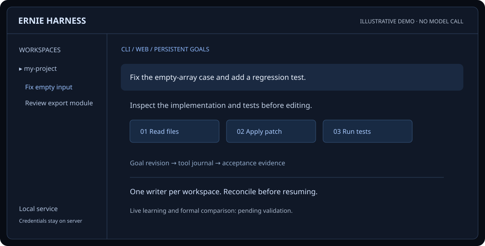

<div align="center">
  
  <h1>ERNIE Harness</h1>
  <p><strong>同一个编程内核，连接终端、Web 与持久目标。</strong></p>
  <p>围绕 ERNIE 5.5 Flash Preview 构建的独立 TypeScript 编程工作台。</p>
  <p><a href="README.md">English</a> · <a href="https://luminousyyh.github.io/ernie-harness/">网站与文档</a> · <a href="docs/user/guide.zh-CN.md">使用指南</a> · <a href="docs/maturity.md">证据与状态</a></p>
  <p><a href="LICENSE"></a>  </p>
</div>

理解仓库、修改代码、运行验收，把每次执行的证据与目标放在一起。CLI、终端界面与本地 Web 共用执行内核、SQLite 日志与累计预算。应用默认中文；展示站提供完整中文与英文静态页面。

**当前状态：集成与验证中。** 学习、扩展与隔离改进机制正在集成。离线检查、真实模型冒烟和正式比较属于不同证据。当前版本**尚未宣称成熟**；学习与改进的真实模型验收、正式比较均**待完成，尚未完成**。性能判断请先查看[成熟度门槛](docs/maturity.md)。



*独立绘制的界面示意。[打开静态交互演示](https://luminousyyh.github.io/ernie-harness/#experience)。演示使用示意数据，不调用模型。真实操作录像待审查与录制。*

## 能力

| 方向 | 提供什么 | 边界与证据 |
| --- | --- | --- |
| 编程工具 | 文件读取、检索、补丁、Shell、测试与 Git 差异 | 本机 Shell 属可信执行；文件边界检查不是通用系统沙箱 |
| 共享工作区 | CLI、终端、Web、工作区选择与独立对话 | 每个工作区一个写入者；浏览器通过 HTTP/SSE 获取状态，不接收模型密钥 |
| 持久目标 | 计划、检查点、依赖、暂停恢复与版本化验收 | 中断后结果不明的写操作必须先核对 |
| 模型与预算 | 固定免费 ERNIE 路由，累计计入重试与辅助调用 | 无付费或其他模型回退；免费额度与可用性受服务限制 |
| 上下文 | 活动用量、声明窗口、估计与压缩分别呈现 | 估算 token 不等于提供商实测 |
| 学习 | 带来源的经验候选、作用域检索、反思与整理模块 | 正在集成；尚无跨任务学习收益结论 |
| 扩展 | AGENTS/技能发现、MCP 配置与可信插件接口 | 新模块正在集成；支持范围以源码接口和测试为准 |
| 改进 | 候选搜索、隔离仓库、评估记录与归档 | 晋升需要证据与策略门槛；不自动构成性能收益 |
| 评测 | 开发与正式协议、记录与证据查看 | manifest 或模拟结果不等于已完成真实试验 |

## 快速开始

Windows / Linux 需要 **Node.js 24.9+**、**pnpm 10.30.3**。实际模型执行需要能访问指定免费路由的 OpenRouter 凭据。

```sh
git clone https://github.com/Luminousyyh/ernie-harness.git
cd ernie-harness
pnpm install --frozen-lockfile
pnpm build
pnpm cli setup
pnpm cli open
```

`setup` 隐藏输入凭据；Windows 使用当前用户 DPAPI，Linux 使用私有凭据文件。也可在运行时环境提供 `OPENROUTER_API_KEY`。真实密钥不能出现在提交的配置、命令记录、截图或浏览器页面。

`open` 启动或复用本地服务并打开已认证工作台；Windows 也可使用 `start-ernie.cmd`。前台服务使用 `pnpm cli serve --open`。默认监听 `127.0.0.1:4317`；启动地址里的本地服务令牌不同于模型密钥，认证地址仅限本机使用。

## 在项目中使用

示例采用 Windows 项目路径；Linux 替换为 `/home/you/projects/my-app` 等绝对路径。

```sh
pnpm cli workspace add "D:/projects/my-app" --name "my-app"
pnpm cli workspace list
pnpm cli workspace select <workspace-id>
pnpm cli tui -w "D:/projects/my-app"
pnpm cli run "修复空数组边界并添加回归测试" -w "D:/projects/my-app" -c "pnpm test" --supervised
pnpm cli list
pnpm cli show <goal-id>
pnpm cli reply <goal-id> "补充错误处理"
pnpm cli pause <goal-id>
pnpm cli resume <goal-id>
pnpm cli cancel <goal-id>
pnpm cli doctor
```

监督目标必须提供明确验收命令。未指定 `-w` 的新 CLI 目标使用当前选中工作区。继续对话会保留历史与累计预算，并递增目标版本。关闭界面不会取消后台目标；服务退出会暂停工作。恢复时先核对未完成的工具记录，再继续执行。详见[使用与恢复指南](docs/user/guide.zh-CN.md)。

## 架构

```text
CLI / 终端 / Web
        │ HTTP + SSE
        ▼
Server ── Engine ── Supervisor
             │             │
       项目工具         隔离 worktree
             │             │
        SQLite 日志 + 累计预算
             │
      OpenRouter → 指定免费 Baidu 路由
```

[contracts](src/contracts) 只定义数据，不依赖实现。[core](src/core)、[store](src/store)、[supervisor](src/supervisor) 分别负责执行、持久状态与调度；[provider](src/provider) 管理模型访问。[extensions](src/extensions)、[learning](src/learning)、[improvement](src/improvement) 在该内核周围增加有边界的机制。详见[架构与信任边界](docs/user/architecture.zh-CN.md)。

仅允许 `baidu/ernie-5.5-flash-preview:free`，使用配置的 Baidu 零价路由与 `high` 推理。配置档位不等于当前路由可用性的真实验证。辅助、标题、反思、改进和重试调用必须计入相应累计预算；免费额度不足时停止新请求并保留状态。

默认目标累计上限：20 次模型请求、200 万输入 token、12.8 万输出 token（含推理）、30 分钟活动时间；每次输出最多 16384 token。请求前持久化保守预留，错误与中断不会清空消耗。

## 学习与改进

[ACE](https://arxiv.org/abs/2510.04618) 与 [Reflexion](https://arxiv.org/abs/2303.11366) 启发经验提取、作用域检索、文字反思与整理。Meta / MESH / [SICA](https://arxiv.org/abs/2504.15228) / Hyperagents 启发任务执行和改进提案分离、隔离候选、评估与可回滚决策。这是机制借鉴，不宣称复现全部原论文系统。

```text
带来源的任务证据 → 经验或补丁候选
    → 有边界的检索 / 隔离验证
    → 独立验收 → 晋升或保留候选
```

经验是建议，不是更高优先级指令；模型反思不是验收证据。正式评测不能读取保留集答案、隐藏测试或生产学习产物。补丁晋升必须关联当前候选版本、测试证据、保护检查与所需审查。[机制与源码对照](docs/research/harness-learning.md) 明确区分模块实现、集成进度和真实模型证据。

## 扩展

正在完善的扩展层分别定义技能上下文、MCP 工具与可信进程内插件。MCP 凭据引用运行时环境变量名，不把真实值保存到配置。插件代码属于可信代码，不是沙箱。扩展内容保留来源，不得改变固定模型策略或绕过审批边界。

从[扩展教程](docs/user/extensions.zh-CN.md)开始：小型插件例子、实际配置结构、源码工具扩展路径与行为检查。集成与真实互操作仍需各自的证据；存在配置文件不等于连接成功。

## 验证与证据

```sh
pnpm typecheck
pnpm test
pnpm build
node scripts/site-build.mjs --check
pnpm site:qa
```

[Windows/Linux CI](.github/workflows/checks.yml) 配置离线类型、行为、构建、网站与打包元数据检查。配置不等于通过记录，应查看对应提交的运行结果。浏览器 QA 覆盖两种语言、五种宽度、语言锚点、无 JavaScript 阅读、键盘、指针/焦点显现保护、动画偏好和仅本地请求。通过 `pnpm exec playwright install chromium` 安装 Chromium，或用 `ERNIE_BROWSER` 指定浏览器；Windows 可使用已安装 Edge。

[真实验证记录](docs/LIVE_VALIDATION.md)、[评测协议](docs/evaluation.md)、[评测目录](eval/README.md) 独立记录证据。144 次正式比较只有外部验收证据齐全后才算完成。历史冒烟/开发快照不能代表 Harness 排名，也不能证明新机制通过验收。网站 QA 不需要真实模型调用。

## 文档与路线

- [中文网站](https://luminousyyh.github.io/ernie-harness/) · [English website](https://luminousyyh.github.io/ernie-harness/en/)
- [使用](docs/user/guide.zh-CN.md) · [架构](docs/user/architecture.zh-CN.md) · [扩展](docs/user/extensions.zh-CN.md)
- [学习机制与来源](docs/research/harness-learning.md) · [成熟度门槛](docs/maturity.md) · [变更记录](docs/CHANGELOG.md)
- 接下来：完成集成与 Windows/Linux 行为验证，收集获准的真实学习/恢复证据，完成独立比较，经审查后录制真实操作流程。

## 参与与许可证

请先阅读[贡献指南](.github/CONTRIBUTING.md)。保持改动聚焦，遵守工作区所有权，补充合适的行为检查，单独报告真实验证。运行数据库、凭据、依赖缓存、完整轨迹与部署压缩包不提交源码。实验文档中的远程路径属于作者环境，使用时需自行配置。

项目原创代码采用 [MIT](LICENSE)。第三方材料保留上游许可证；MIT 不授予第三方商标的权利。本项目独立开发，与百度、DeepSeek、Pi 或 Anthropic 无隶属关系。

README 信息组织参考 [wangmiaozero/pi-harness 固定版本 `ab32e788f56afdb9367c3a1a6b33a19e5d0058cd`](https://github.com/wangmiaozero/pi-harness/tree/ab32e788f56afdb9367c3a1a6b33a19e5d0058cd)：居中身份、能力总览、快速开始、架构与贡献入口。本文文字、代码和 SVG 示意独立创作；没有复制 AGPL 实现或上游性能结论。参见[来源说明](docs/user/sources.md)及现有[第三方声明](docs/THIRD_PARTY.md)。
